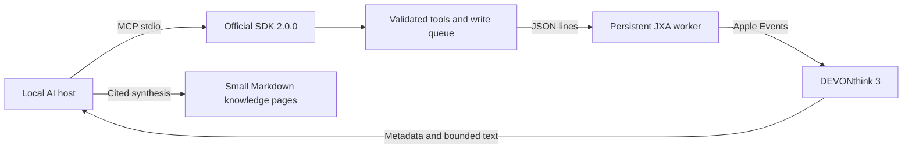

# Design and research — 2026-09-08

## Product decision

An agent should research and organize a DEVONthink 3 archive without copying its originals into a Git repository. The existing DEVONthink index remains the retrieval engine. The MCP server translates bounded, explicitly scoped operations into Apple Events; the AI host reasons over the returned evidence.

One long-lived `osascript` worker serves the whole MCP session. It keeps the application connection and database discovery warm, while visibility decisions are recomputed for every request so a changed tag or parent is never cached across calls. The worker is recycled after 2,000 requests or five idle minutes and is killed on timeout or cancellation; a write whose worker dies is reported with an unknown outcome.

No duplicate embeddings, vector database, browser automation, local HTTP service or cloud account are needed for this workflow. A remote HTTP transport is a separate future product decision because it changes the authentication and data-exposure model.

## What is current

Research date and implementation date are **2026-09-08**. The following are primary sources; feature claims from upstream projects are not treated as local test results.

| Finding | Decision | Primary source |
| --- | --- | --- |
| MCP 2026-07-28 introduces the stateless core, discovery, cacheable lists and a formal extensions framework | Use the current official SDK instead of implementing protocol messages ourselves | [Release announcement, July 28](https://blog.modelcontextprotocol.io/posts/2026-07-28/), [specification changelog](https://github.com/modelcontextprotocol/modelcontextprotocol/blob/main/docs/specification/2026-07-28/changelog.mdx) |
| TypeScript SDK v2 is the stable line; `@modelcontextprotocol/server` and `client` resolve to 2.0.0 in npm at verification | Pin the SDK and commit the lockfile; verify both modern and legacy client flows | [SDK v2 documentation](https://ts.sdk.modelcontextprotocol.io/v2/), [stdio and legacy clients](https://ts.sdk.modelcontextprotocol.io/v2/serving/legacy-clients) |
| Typed tool results, resources, prompts, progress and cancellation are supported SDK primitives | Expose small purpose-specific tools, structured results, source resources and reusable research/organization prompts | [Tools](https://ts.sdk.modelcontextprotocol.io/v2/servers/tools), [resources](https://ts.sdk.modelcontextprotocol.io/v2/servers/resources), [progress and cancellation](https://ts.sdk.modelcontextprotocol.io/v2/servers/logging-progress-cancellation) |
| The August roadmap focuses on agent messaging, HTTP hardening, identity and improved primitives | Follow stable capabilities; do not add speculative remote-agent infrastructure to a local desktop adapter | [Roadmap, August 22](https://blog.modelcontextprotocol.io/posts/mcp-roadmap/) |
| DEVONthink's native MCP arrived in the version 4 line and includes its own redaction/exclusion options | Recommend the native server to version 4 users; implement explicit version 3 scope instead of claiming those controls carry over | [Vendor MCP introduction](https://www.devontechnologies.com/blog/20260526-devonthink-mcp-server), [release history](https://www.devontechnologies.com/apps/devonthink/releases) |
| DEVONthink 4 changes the scripting application name and record type terminology | Address the version 3 bundle ID and verify `type()` against the installed dictionary | [Vendor upgrade notes](https://www.devontechnologies.com/apps/devonthink/upgrade) |

Some indexed search results still describe SDK v2 as beta. The live npm package metadata and current official v2 documentation establish the implementation baseline; an old search snippet does not override those sources.

## Reuse assessment

| Candidate | What was useful | Why this repository is separate |
| --- | --- | --- |
| [dvcrn/mcp-server-devonthink](https://github.com/dvcrn/mcp-server-devonthink) | Established AppleScript/JXA integration and a broad operation inventory | Reviewed main targets `Application("DEVONthink")` and `recordType()` in important paths; those do not establish version 3 compatibility. Its LICENSE is GPL-3.0 while package metadata says MIT. No implementation code was copied. |
| [juangrukat/mcp-devonthink](https://github.com/juangrukat/mcp-devonthink) | Tool profiles and graph-oriented research workflows | A larger Python system with maintenance snapshots and additional messaging actions exceeds the local version 3 bridge scope. No implementation code was copied. |
| [istefox/istefox-dt-mcp](https://github.com/istefox/istefox-dt-mcp) | Referenced in prior version 4 MCP discussions | The repository could not be retrieved at the research date (404). It was not a reproducible implementation dependency. |
| [Official MCP TypeScript SDK](https://github.com/modelcontextprotocol/typescript-sdk) | Protocol, validation, resources, prompts and client compatibility | Reused as a dependency. Runtime has only this SDK and Zod as direct dependencies. |

The server is an independent MIT implementation based on the installed application's scripting dictionary and the official SDK. It does not redistribute DEVONthink or community server source code.

Reviewed snapshots: dvcrn `e25463a048a78d714510553860cb5c5af6c0a64d`; juangrukat `78bc835b3ca4568012035f51db11f1ec38cbc436`.

## User workflows and acceptance criteria

| Workflow | Acceptance criterion |
| --- | --- |
| Research a question | Native search → metadata → bounded text → item-link citation; no whole-archive prompt dump |
| Inspect an archive | Enumerate groups and records with live pagination; keep empty/unindexed records visible in metadata browsing |
| Organize documents | Native classification is advisory; preview a concrete change, validate current revision, apply only authorized edits |
| Maintain a knowledge wiki | Summaries cite DEVONthink item links; originals and binary assets stay in the archive |
| Protect excluded material | Check database, record and all parent paths before tools, resources and receipt replay return data |
| Recover from errors | Actionable sanitized errors; no automatic repeat of an uncertain write; a receipt prevents same-process duplicate execution |

## Implementation boundaries

- `config.js`: fail-closed environment parsing, identifiers and error type.
- `server.js`: stable tool catalog, strict input/output schemas, annotations, prompts and resources.
- `bridge.js`: persistent worker lifecycle and JSON-line framing, one-shot fallback, serialization, filesystem import checks, revision comparison, preview-state reuse and bounded receipts.
- `jxa.js`: fixed version 3 operation dispatcher. Runs once for `--doctor` or as a persistent worker; receives data on stdin, validates native scope, and calls Apple Events. No model-generated script is evaluated.
- `scripts/benchmark.mjs`: opt-in synthetic benchmark. Creates one temporary database, measures both transports over the same records, and removes the fixture.
- `index.js`: stdio entry point and local-only setup diagnostics.

The catalog remains stable for the lifetime of a process. Enabling writes requires a restart. `dt3_get_records` and `dt3_read_texts` batch reads only; no batch mutation tool is exposed. A batch read reports per-record errors and a resumable cursor instead of failing the whole page. MCP tool annotations describe behavior; they are not the security boundary. The server-side checks enforce scope regardless of client behavior.

A revision hashes the current native name, tags, comment, dates, stored content hash, flags, parents and lock/index state. A preview records that state under its `request_id`; an authorized apply reuses it, so the bridge does not read the same metadata twice. The JXA dispatcher still compares the state immediately before mutation. If the preview was evicted or the record changed, the bridge falls back to a fresh read and the native comparison still rejects a stale write. This reduces stale edits; it does not create a database transaction or prevent every concurrent manual edit between Apple Events.

DEVONthink's `create record with` consumes a dictionary with the key `plain text`. JXA's `plainText` accessor is appropriate for later property edits but silently failed to populate a new Markdown document in the live test. The creation implementation uses the dictionary label, and the Unicode roundtrip test covers this compatibility detail.

## Deliberate limits

No permanent deletion, cross-database moves, group relocation, arbitrary JavaScript, URL fetching, global preference changes, third-party messaging or autonomous background maintenance is exposed. Indexed originals stay read-only. Long jobs, task extensions, distributed locks and durable write journals should be added only when a concrete workflow outgrows the documented per-process limits. Bulk exports are built from bounded pages (`dt3_list_group`/`dt3_search`) plus `dt3_get_records`/`dt3_read_texts`, not from an unbounded dump.

PDF/OCR availability is determined by DEVONthink's index. The server does not claim complete parsing of spreadsheets, archives, scans or audiovisual media. Large folder ingestion remains a native DEVONthink operation, separate from research and organization over MCP.
